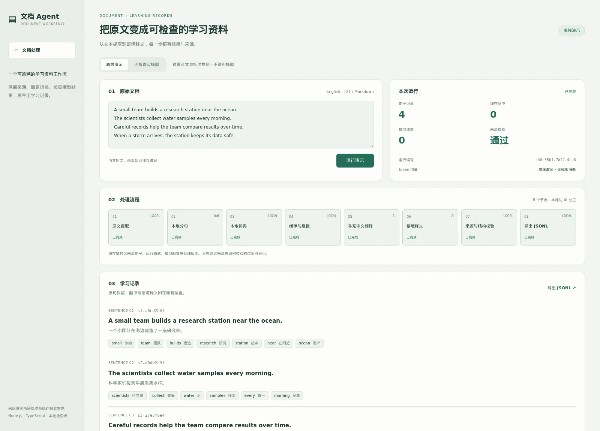
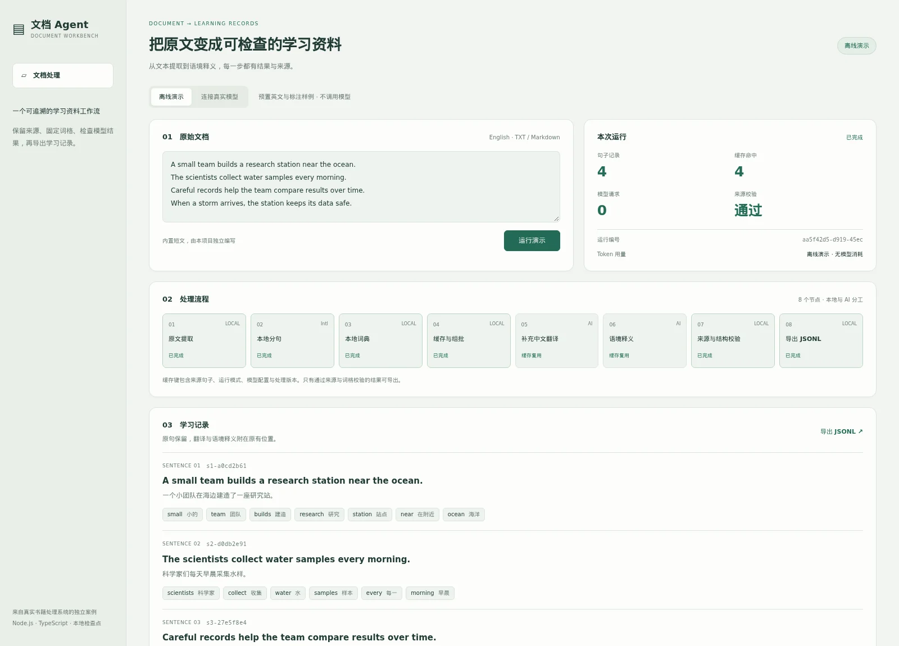
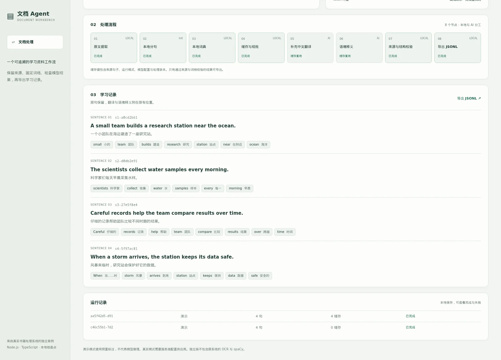
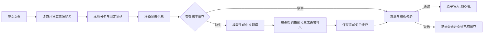
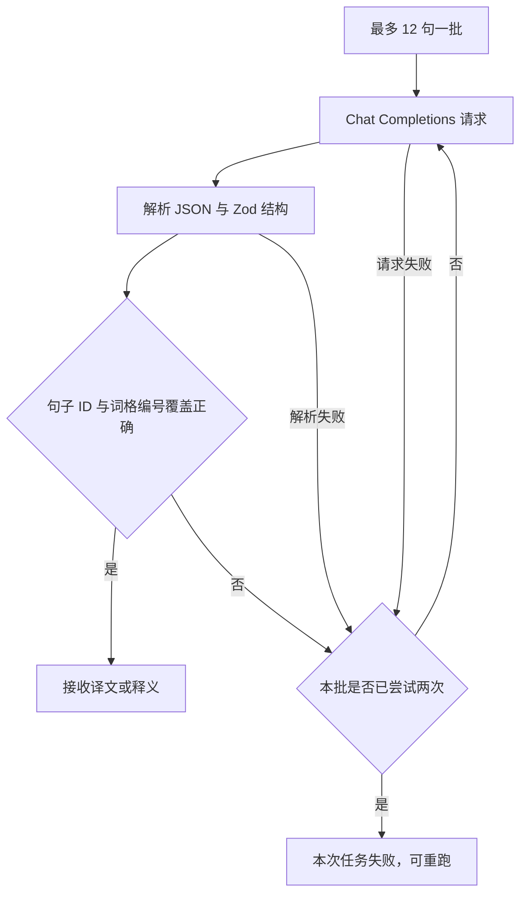

# 文档 Agent 工作台

**把英文原文处理成可检查、可追溯、可重复运行的学习记录。**

从实际运行的书籍处理系统中拆出的独立案例：保留工作流节点执行、来源匹配与文档读取逻辑，提供一个不依赖原学习站、账号系统或数据库的本地工作台。

[应用预览](#应用预览) · [AI 处理流程](#ai-处理流程) · [快速开始](#快速开始) · [来源与拆分范围](docs/extraction.md)



## 适合看什么

- **本地与模型分工**：读取、分句、缓存和校验由程序执行，翻译和语境释义由模型完成。
- **限制模型输出**：模型只能补充句子 ID 对应的译文、词格编号对应的释义，不能替换英文原文。
- **有限失败恢复**：真实模式每批至多尝试两次；已落盘的句子缓存可以在重跑时复用。
- **可检查的交付物**：运行事件、来源 SHA-256、结构化记录与 JSONL 导出都保存在本地。

这是一个受控 AI 工作流示例。执行器按已声明的依赖运行，模型不负责自由选择流程节点。

## 应用预览

图片来自真实启动的应用和实际执行的离线演示。英文短文、译文与词汇说明均由本项目独立编写；**演示使用预置标注，不调用模型，也不把预置文本当作在线模型效果。**

### 第二次运行：复用已经完成的句子

第一次执行完成四条学习记录。再次运行相同来源、模式和处理版本后，命中四条缓存，翻译与释义节点跳过。



### 查看原文位置、中文释义和运行历史

导出的 JSONL 保留 `sourceSha256`、稳定句子 ID、英文原句、译文与原词格。界面以文本节点渲染来源和模型内容。



## AI 处理流程





来源校验使用原系统的 `createSourceMatcher`。最终记录必须保持原句和词格内容一致；译文是否准确、释义是否贴合语境，仍需要人工检查，结构正确不等于语义正确。

## 快速开始

需要 **Node.js 26+、pnpm 12.3.4**。

```sh
pnpm install --frozen-lockfile
pnpm demo
```

打开 `http://127.0.0.1:3118`。服务启动后处理内置四句短文；再点击「运行演示」查看缓存复用。无需密钥、Docker 或外部数据库，服务只监听本机。

### 连接真实模型

```sh
export DOCUMENT_AGENT_API_KEY=your-own-key
export DOCUMENT_AGENT_BASE_URL=https://your-provider.example/v1
export DOCUMENT_AGENT_MODEL=your-model-id
pnpm dev
```

在界面选择「连接真实模型」，粘贴英文文本并运行。供应商必须支持 Chat Completions 和稳定的 JSON 输出；密钥由服务端环境变量读取，不下发到浏览器，不写入运行文件。正文会发送到配置的供应商。

### CLI 文件处理

```sh
# 离线演示：只支持自带短文
pnpm process examples/reading.txt

# 真实模型：自己的文档
pnpm process /path/to/book.epub --live
pnpm process /path/to/document.docx --live
pnpm process /path/to/notes.md --live

# 构建运行
pnpm build
pnpm start
```

CLI 支持 TXT、Markdown、DOCX、EPUB 和有文字层的 PDF。PDF 需要系统已安装 `pdftotext`；扫描 PDF 会明确报错，不伪造识别结果。Web 界面目前接收粘贴的文本；文件读取适配器由 CLI 使用。输入文件最多 16 MiB，提取文本最多 200 万字符，当前单文档最多 500 个英文句子；不同格式和语言仍需按真实材料核对。

### 输出与配置

```text
data/
  runs/<run-id>/job.json        # 状态、节点事件、句子与已知用量
  runs/<run-id>/results.jsonl   # 通过校验的结果
  cache/<fingerprint>.json     # 完成句子缓存
```

`DOCUMENT_AGENT_DATA_DIR` 可改变数据目录，`PORT` 可改变端口。缓存指纹包含处理版本、运行模式、模型端点和模型 ID，不包含密钥。相同来源重跑创建新运行记录并复用缓存，不是恢复同一运行 ID 的整个进程。供应商未报告的 Token 用量显示为未知，离线演示显示无模型消耗。

## 来源与拆分范围

| 原系统能力 | 独立案例 |
| --- | --- |
| 工作流依赖检查、节点事件 | 直接复用 `WorkflowRun` |
| 原文匹配与边界检查 | 直接复用 `createSourceMatcher` |
| DOCX／EPUB／PDF 原文读取 | 从 Worker 适配，移除数据库和挂载路径约束 |
| spaCy 本地语言模型 | 本版使用 `Intl.Segmenter`，不声称包含词性分析 |
| ECDICT 大词典 | 离线演示为小型示例词典；真实释义交给模型 |
| 逐页 OCR、GPU 优化、阅读站发布 | 未迁入本版；最后一步是本地 JSONL 导出 |

原始出处、保留机制与改动说明见 [extraction.md](docs/extraction.md)。该案例的价值在于可独立复现的处理边界与运行机制，不代表原生产系统的全部功能。

## 重现截图

```sh
pnpm exec playwright install chromium
pnpm screenshots
```

脚本启动独立临时服务，实际执行演示、重跑缓存、截图三个页面位置并关闭服务。可用 `PLAYWRIGHT_CHROMIUM_EXECUTABLE` 指定现有 Chromium。截图和样例不包含生产书籍、账号或 API 密钥。

## 实现入口

- [`src/pipeline.ts`](src/pipeline.ts)：批次、模型请求、校验与缓存。
- [`src/workflow.ts`](src/workflow.ts)：原项目的节点定义与执行器。
- [`src/source-reader.ts`](src/source-reader.ts)：格式读取适配器。
- [`src/source-sentence.ts`](src/source-sentence.ts)：原文匹配。
- [`src/server.ts`](src/server.ts)：本机 HTTP 工作台与导出。
- [`examples/`](examples/)：独立编写的短文、译文和演示词典。

本版用于可信本机环境，没有多租户鉴权，不适合直接暴露为公网服务。模型输出仍可能错误；当前尚未完成真实供应商、各类长文档与扫描 OCR 的完整验收。

## 凭据与发布检查

示例和截图使用虚构数据，真实模型密钥由使用者自行配置。发布前运行 `node scripts/check-secrets.mjs`；历史检查与凭据边界见 [SECURITY.md](SECURITY.md)。
